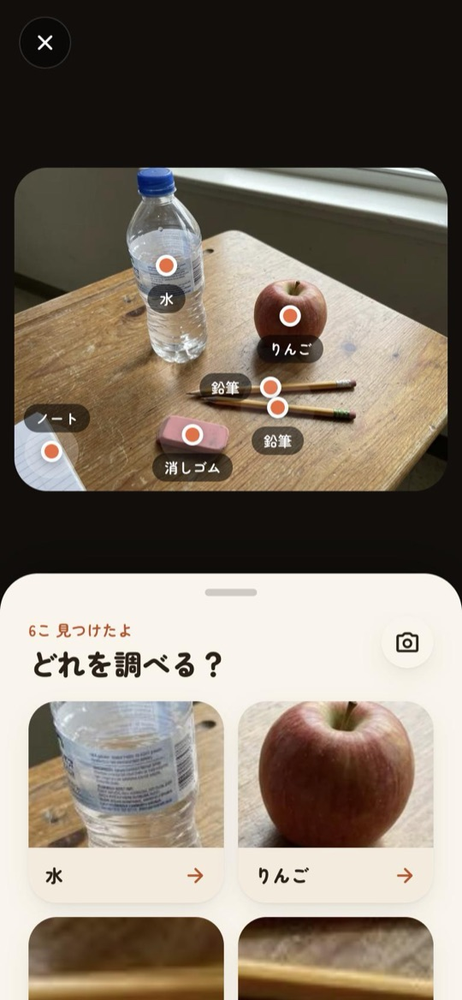
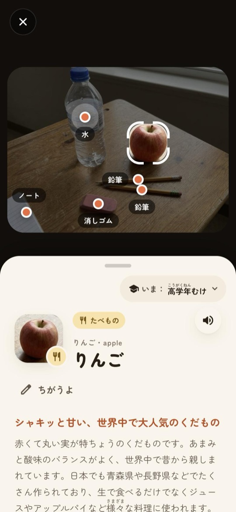
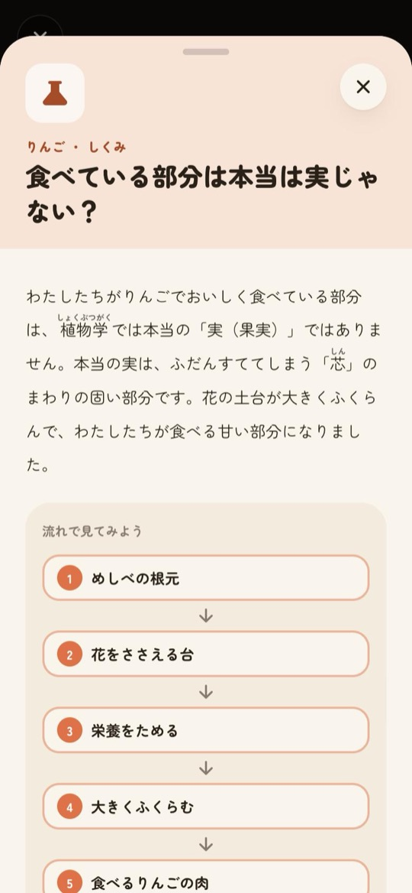
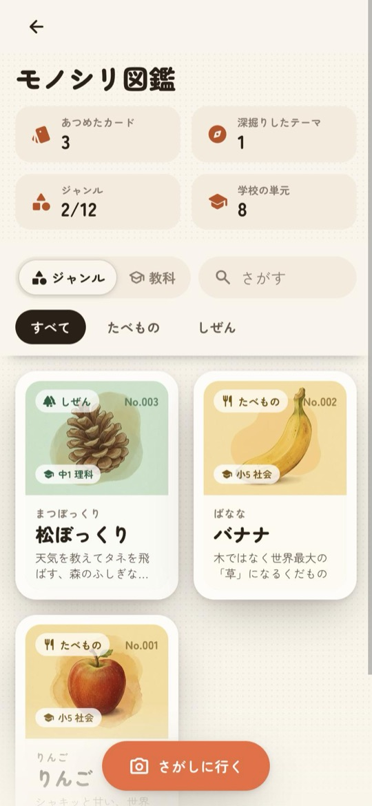
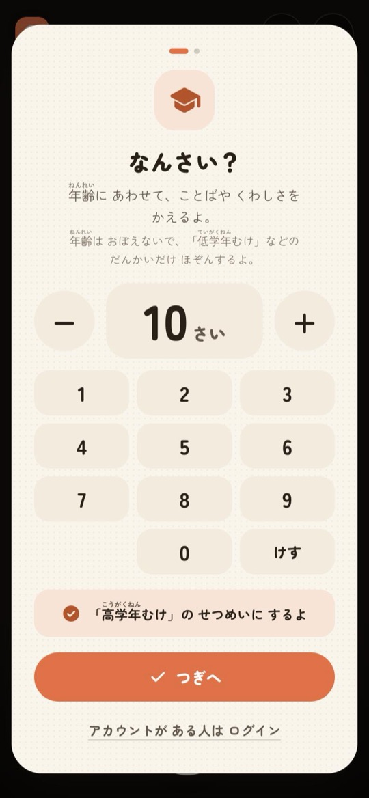
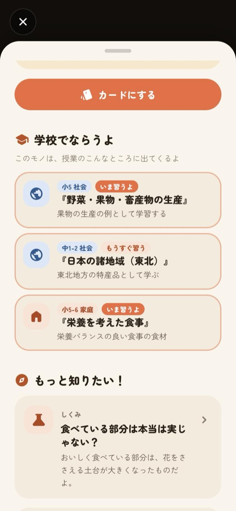
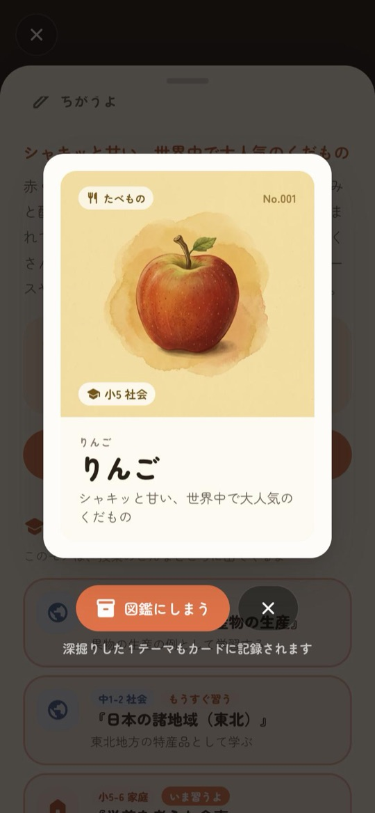
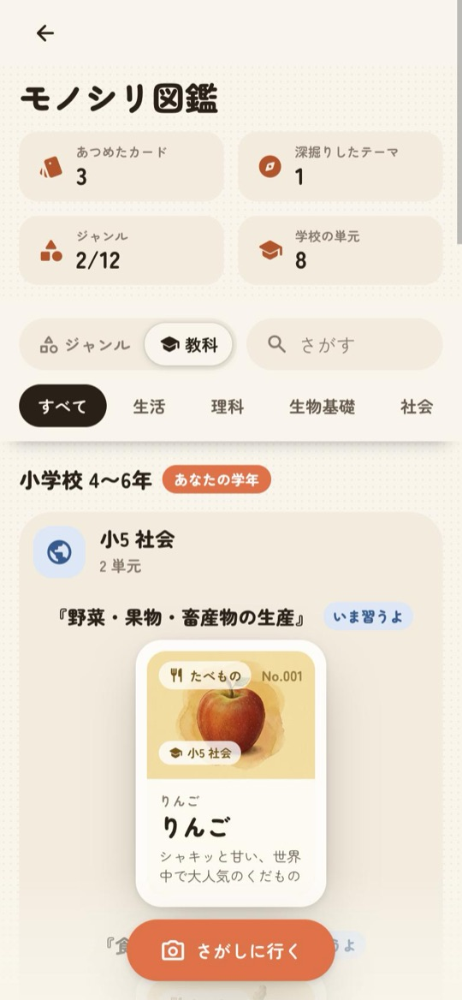
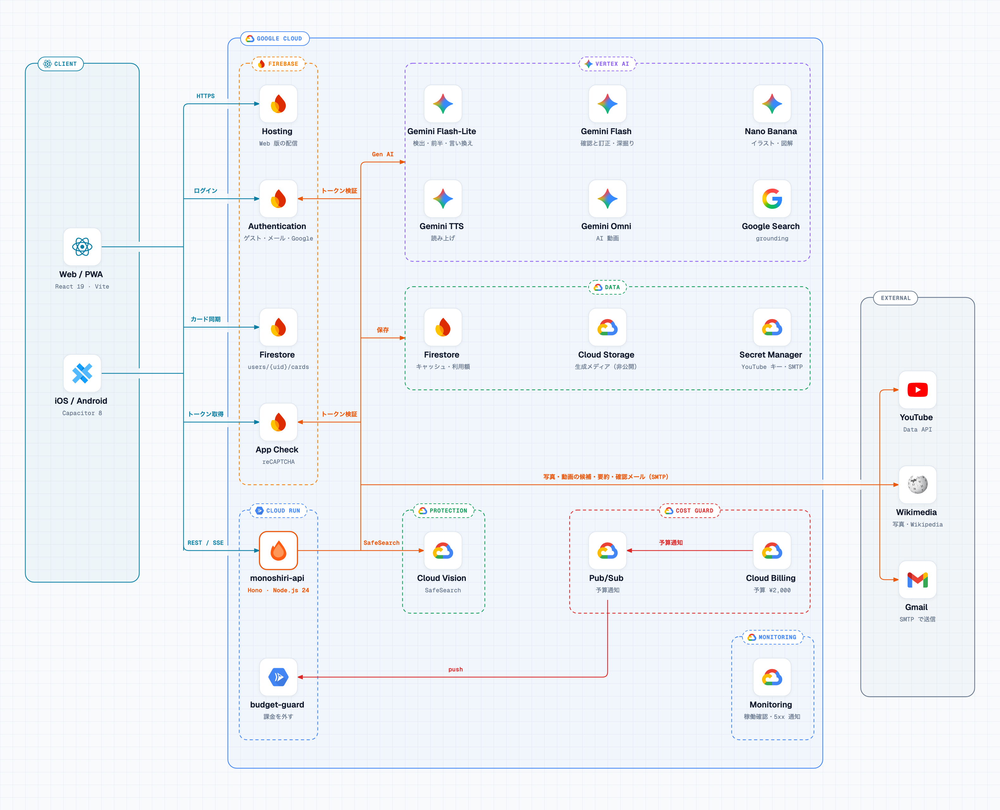

<div align="center">


# モノシリ

**撮るだけで、身の回りが教科書になる。**

身の回りのモノを撮ると、Gemini が写っているモノを見つけ、<br>
Google 検索で確かめた解説と「なぜ？」の問いで深掘りし、学校で習う単元に結び付けます。

[アプリを開く（monoshiri.web.app）](https://monoshiri.web.app) ・ Web / iOS / Android ・ 教育カテゴリ（DevFest GDGoC Japan Hackathon 2026）

</div>

<p align="center">
  
  
  
  
</p>

> **English summary:** Monoshiri is a learning app that turns everyday objects into lessons. Take a photo and Gemini (on Vertex AI) finds the objects, explains each one with Google Search grounding, and lets you dig into questions such as "how is it made?" with diagrams, photos, videos, read-aloud and quizzes. Each object is linked to units of the Japanese national curriculum, and explored objects become illustrated cards in your collection. Web + iOS + Android (Capacitor), with a Hono API on Cloud Run. The UI and docs are in Japanese.

## 目次

- [どんなアプリか](#どんなアプリか)
- [使い方の流れ](#使い方の流れ)
- [くふうしたところ](#くふうしたところ)
- [技術スタック](#技術スタック)
- [しくみ](#しくみ)
- [すぐに動かす](#すぐに動かす)
- [ドキュメント](#ドキュメント)
- [チーム・ライセンス](#チームライセンス)

## どんなアプリか

教科書の知識は、身の回りのモノとつながったときに「自分ごと」になります。モノシリは、子どもが気になったモノを撮るだけで、そのモノの「どうやってできる？」「なぜこの形？」を調べ、**学習指導要領の 219 単元のどこで習うか**まで示します。

- **年齢に合わせて書き分ける**: 最初に年齢を入れると、小学校低学年・高学年・中学生・高校生以上の4段階に変換します（年齢そのものは保存しません）。漢字・表現・くわしさを段階ごとに変え、小学生向けにはふりがなを付けます。
- **事実を検索で確かめる**: 解説と深掘りは Google 検索のグラウンディングで裏付け、参考にしたページを表示します。
- **集めて、ふり返る**: 調べたモノは絵本風のイラストカードになり、図鑑に集まります。図鑑は教科・学年ごとに並べ替えられ、「いま習う」「もうすぐ習う」単元がわかります。

## 使い方の流れ

| 1. 年齢を入れる | 2. 撮って、えらぶ | 3. 解説を読む | 4. 学校の単元を知る |
|:---:|:---:|:---:|:---:|
|  |  |  |  |
| 年齢から段階を決め、プライバシーポリシーに同意する。アカウントがあればここからログイン | 写っているモノ（最大6個）に印が付く。カメラが使えなければ写真やサンプルでも | 名前・ひとこと・説明・豆知識。段階に合わせた文章とふりがな | 「小5 社会『野菜・果物・畜産物の生産』」のように、関係する単元を最大3つ |

| 5. 問いで深掘りする | 6. カードにする | 7. 図鑑に集める | 8. 教科で見直す |
|:---:|:---:|:---:|:---:|
|  |  |  |  |
| 6つの問いから選ぶと、流れ図・写真・動画・AI の図解・読み上げ・クイズで深掘り | AI が描いたイラストでカードにする（イラストの完成は待たずに保存） | ジャンルで絞り込み、検索、裏返してノート | 集めたカードを教科×学年の単元に並べる |

画面ごとの細かい動きは [docs/features.md](docs/features.md) にまとめています。

## くふうしたところ

- **待たせない解説**: まだ誰も調べていないモノは、軽いモデルが検索なしで書いた解説を約2〜3秒で先に出し、その間に Google 検索で初稿を確かめて直し、豆知識と問いを足します（完成まで約10秒）。調べ済みのモノは共有キャッシュから1秒以内に出ます。
- **子どもが安心して使える**: 撮った写真はどこにも保存せず、Cloud Vision の SafeSearch で不適切な写真を断ります。全員が見る解説は写真ではなく名前だけから作るので、写真に書かれた文字で本文を誘導できません。学びの記録は日ごとの合計回数だけで、個人と結び付けません。
- **費用を上限で守る**: アプリ内の推定額メーター、アカウントごとの上限、予算通知で課金を外す関数などの多段の上限と、全ユーザーで共有するキャッシュ・段階の言い換えで、合計 ¥2,000 の中で動かします（[docs/cost.md](docs/cost.md)）。
- **ネイティブらしさ**: iOS は Liquid Glass のネイティブボタンと端のスワイプでの戻る操作、Android は戻るボタンでの段階的な戻る操作と SplashScreen API に対応しています。

## 技術スタック

| 領域 | 使っているもの |
|---|---|
| フロントエンド | Vite 8、React 19（React Compiler）、TypeScript、TanStack Router、Tailwind CSS v4、Motion、Dexie（IndexedDB）、marked + DOMPurify、BudouX |
| ネイティブ | Capacitor 8。iOS は Swift 6（Liquid Glass のボタン）、Android は AGP 9.5 / Gradle 9.9 / targetSdk 37 |
| API サーバー | Hono on Node.js 24（TypeScript をそのまま実行）、Cloud Run、Nodemailer、sharp |
| AI | Vertex AI の Gemini（物体検出・解説・深掘り・クイズ・画像・読み上げ・動画）、Grounding with Google Search |
| データ | Firebase Auth（匿名・メール／パスワード・Google）、Firestore、Cloud Storage（非公開バケット）、Secret Manager |
| 保護 | Firebase App Check（reCAPTCHA Enterprise）、Cloud Vision SafeSearch |
| 監視 | Cloud Monitoring（稼働確認・5xx のアラート）、Cloud Billing の予算通知 |
| テスト・CI | `node --test`（API）、Firestore エミュレーター（ルール）、GitHub Actions（Workload Identity Federation で鍵なしデプロイ） |
| 外部データ | Wikimedia Commons、Wikipedia、YouTube Data API |

## しくみ



1回の「調べる」は、検出（`/api/detect`）→ 2段階の解説（`/api/explore/stream`、SSE）→ 単元（`/api/units`）→ 深掘り（`/api/deep`、SSE）→ カード（`/api/illustrate`）の順に進みます。生成した結果は Firestore に保存して全ユーザーで使い回し、調べたことのあるモノは作り直さずにすぐ表示します。

詳しくは [docs/architecture.md](docs/architecture.md)（流れ・ディレクトリ構成・データの保存先）と [docs/api.md](docs/api.md) にあります。

## すぐに動かす

課金を有効にした Google Cloud プロジェクトと、同じプロジェクトの Firebase（匿名・メール／パスワード・Google のログインを有効にし、Web アプリを登録）が必要です。開発時の API は Firestore と Cloud Storage の代わりにメモリとローカルフォルダを使います。

```bash
git clone https://github.com/Ryuto42/monoshiri.git && cd monoshiri
(cd server && npm install) && (cd web && npm install)
cp server/.env.example server/.env          # GOOGLE_CLOUD_PROJECT を自分のプロジェクト ID にする
PROJECT=<your-project-id> node infra/write-web-env.mjs --local
```

```bash
cd server && npm run dev   # API: http://localhost:8080
```

```bash
cd web && npm run dev      # Web: http://localhost:5173
```

前提ツール、エミュレーターでの起動、iOS / Android のビルド、つまずきやすい点は [docs/development.md](docs/development.md) にあります。

## ドキュメント

| ファイル | 内容 |
|---|---|
| [docs/features.md](docs/features.md) | 画面ごとの機能、年齢の段階とふりがな、操作 |
| [docs/architecture.md](docs/architecture.md) | 全体の構成、1回の「調べる」の流れ、ディレクトリ構成、データの保存先 |
| [docs/api.md](docs/api.md) | API の一覧、キャッシュ、エラー |
| [docs/cost.md](docs/cost.md) | 費用の上限と、費用を下げるくふう |
| [docs/development.md](docs/development.md) | 自分の環境で動かす、よく使うコマンド、iOS / Android アプリ |
| [docs/deployment.md](docs/deployment.md) | 自分のプロジェクトへのデプロイ、GitHub Actions |
| [SECURITY.md](SECURITY.md) | 脆弱性の報告と、セキュリティ・プライバシーの設計 |
| [CONTRIBUTING.md](CONTRIBUTING.md) | 開発の流れ、ブランチ、チェック、コードの書き方 |
| [docs/credits.md](docs/credits.md) | 使っているライブラリ・フォント・データとライセンス |

## チーム・ライセンス

チーム「いぬどろぼう」（[@Ryuto42](https://github.com/Ryuto42)、[@Yuru-Yurufu](https://github.com/Yuru-Yurufu)）が開発しました。

コードは [MIT License](LICENSE) で公開しています。サンプル写真・カードイラストなどの生成物は Gemini（Vertex AI）で作ったもので、外部サービス（Google 検索、Wikimedia、YouTube）の内容はそれぞれの規約に従います。
