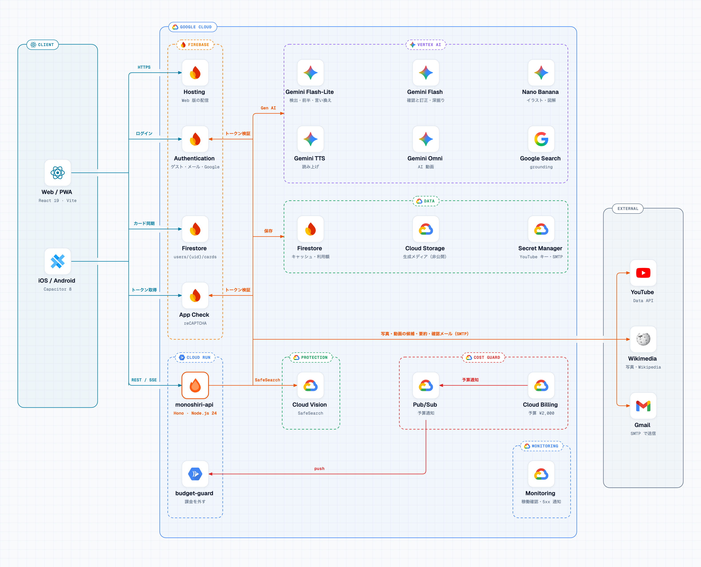
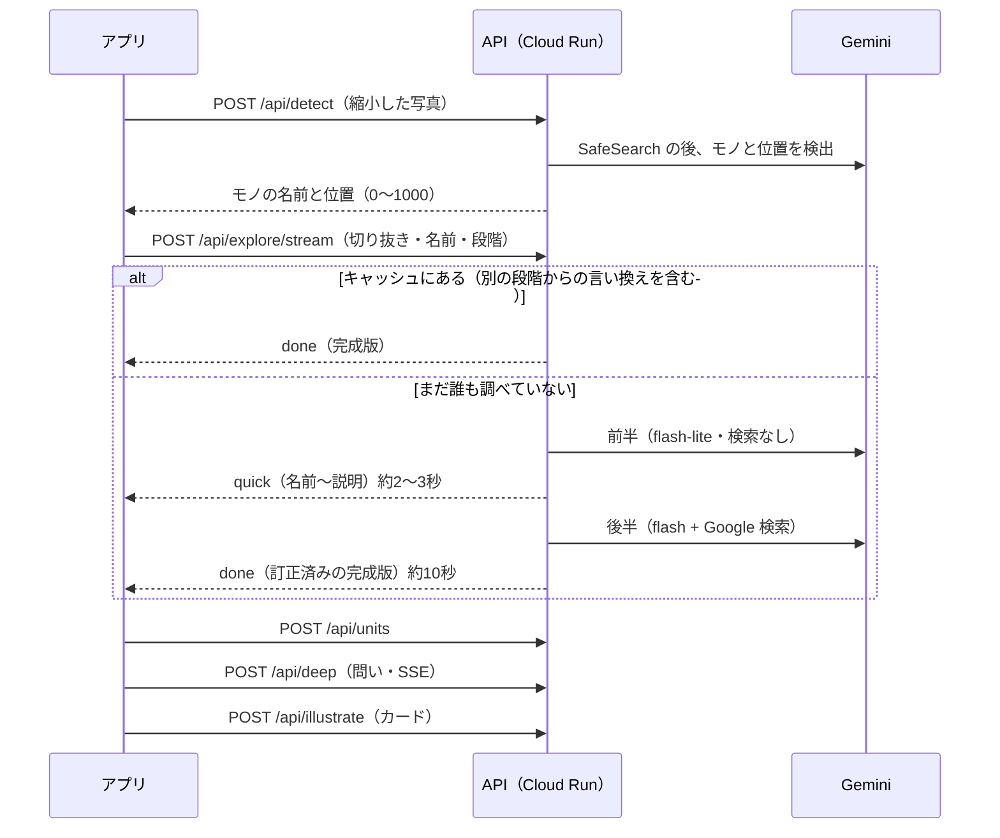

# しくみ

全体の構成、1回の「調べる」の流れ、ディレクトリ構成、データの保存先をまとめます。API の一覧は [api.md](api.md)、費用の守り方は [cost.md](cost.md) にあります。

## 全体の構成



- フロントエンドは Web と iOS / Android で同じコード（`web/`）です。ネイティブ版は Capacitor 8 で包んでいます。
- ゲストは Firebase Auth の匿名アカウントで始まり、メールか Google に紐づけても uid はそのままです。
- 図鑑のカードは端末の IndexedDB にあり、ログインした（メールは確認済みの）アカウントでは Firestore の `users/{uid}/cards` と双方向に同期します。

### 使っている Gemini のモデル

モデル名は `server/src/config.ts` の `MODELS` にあり、`server/.env` の `MODEL_*` で差し替えられます。

| モデル | 使いみち |
|---|---|
| `gemini-3.1-flash-lite` | 物体検出（`box_2d`）、写真からの名前の確認、解説の前半（検索なし）、段階の言い換え、クイズ、単元の選択、深掘りの写真選び |
| `gemini-3.8-flash` + Google 検索 | 解説の後半（初稿の確認と訂正・豆知識・問い）、深掘りの本文 |
| `gemini-nano-banana-2.1` | カードのイラスト、図解イラスト |
| `gemini-3.8-flash-lite-tts` | 読み上げ |
| `gemini-omni-1.2-flash` | AI 動画（Interactions API） |

## 1回の「調べる」の流れ



1. **撮影**: `Viewfinder` がカメラ映像を出し、撮った画像を `lib/image.ts` で縮小して JPEG（base64）にする。
2. **検出**: `POST /api/detect` で、写っているモノと位置（0〜1000 の座標）を受け取り、`Stage` が印を重ねる。
3. **解説**: 選んだモノの切り抜きとラベルを `POST /api/explore/stream`（SSE）に送る。
   - サーバーは別名キャッシュと解説キャッシュを引く。その段階の解説がなくても別の段階の解説があれば、検索せずに言い換えて作る。どちらかで見つかれば `done` を1回だけ返す。
   - 見つからなければ、SafeSearch と、切り抜きからのモノの名前の確認を並べて行う。そのうえで、全員が見る本文に写真の内容が入らないよう、名前だけから2段階で作る。
   - **前半**: 軽いモデル（検索なし）が、名前・読み・ジャンル・ひとこと・説明を書く。説明は「何の仲間で、ふだん何に使うものか」から書き始める。決まった名前の解説がもうキャッシュにあれば、そこで `done` を返す。なければ `quick` として送り、画面はすぐに解説を出す。
   - **後半**: Gemini と Google 検索が、前半の初稿全体（ジャンル・ひとこと・説明）を確かめ、資料と食い違うところだけを直す（名前は変えない。裏付けのない数字・年号・固有名は、裏付けのある説明に置き換える）。あわせて豆知識・6つの問い・キーワードを書く。全体を共有キャッシュに保存して `done` で送り、画面は完成版に差し替える。
4. **単元**: 完成版がそろうと `POST /api/units` で学校の単元（最大3つ）を受け取り、チップで表示する（段階によらず共通のキャッシュ）。
5. **深掘り**: 問いを選ぶと `POST /api/deep` が SSE で本文を流す。写真と動画は `GET /api/media` で取る。図解・動画・クイズは、必要になったときにだけ作る。
6. **カード化**: `POST /api/illustrate` を裏で走らせつつ、カードは単元と一緒にすぐ IndexedDB と Firestore に保存する（`lib/illust.ts`）。イラストが完成したらカードを更新し、吹き出しで知らせる。

画面の状態は `lib/flow.ts` の `Flow` で管理しています（`camera` → `detecting` → `picked` → `exploring` → `explore`、失敗時は `error`）。

## ディレクトリ構成

```
.
├─ web/                        フロントエンド（Web と iOS / Android で共通）
│  ├─ src/
│  │  ├─ main.tsx / App.tsx    起動と画面の土台（カメラの上に図鑑を重ねる）
│  │  ├─ router.tsx            ルート（/、/zukan、/zukan/$cardId、/account、/privacy、/auth/action）
│  │  ├─ screens/              Home（カメラと調べる流れ）、ExploreContent（解説）、TopicPanel（深掘り）、
│  │  │                        Zukan / ZukanUnits（図鑑・教科）、CardDetail、Account と account/、Privacy、AuthAction（メールのリンク）
│  │  ├─ components/           CardFace / CardMaker（カード）、Sheet（下から出るパネル）、Viewfinder / Stage（カメラと印）、
│  │  │                        Onboarding / AgePicker（年齢と同意）、Welcome / Tour（案内）、StageChip（段階）、UnitChips（単元）、
│  │  │                        RubyText（ふりがな）、Phrases（BudouX で文節ごとに折り返す）、Speak（読み上げ）、Markdown、
│  │  │                        SearchEntry / MoreSearch（Google 検索）、LeaveConfirm、LoadingCard、ReadyBubble、SignupNudge、
│  │  │                        Toast、Logo、ui / theme（共通部品とデザインの値）
│  │  ├─ lib/
│  │  │  ├─ api.ts             API クライアント（ID トークンと App Check 付きの fetch、SSE）
│  │  │  ├─ firebase.ts        Firebase の初期化、ゲストログイン、ログイン状態
│  │  │  ├─ account.ts         登録・ログイン・ログアウト・削除、登録のおすすめ
│  │  │  ├─ cards.ts           カードの保存（IndexedDB ⇄ Firestore の同期）
│  │  │  ├─ illust.ts          イラスト生成のジョブと完成の通知
│  │  │  ├─ flow.ts            調べる流れの状態（flow-parse.ts は流れ図の読み取り）
│  │  │  ├─ level.ts           学びの段階（ゲストは端末、ログイン後は Firestore にも）
│  │  │  ├─ welcome.ts / tour.ts  年齢・同意 → 案内 → チュートリアルの順番と、同意の記録
│  │  │  ├─ units.ts           単元の一覧・判定・キャッシュ
│  │  │  ├─ ruby.ts            ふりがな（漢字《かんじ》）の変換
│  │  │  ├─ camera.ts / image.ts  カメラの選択と、写真の縮小・切り抜き
│  │  │  ├─ labelLayout.ts     写真の上の名前が重ならないように置く
│  │  │  ├─ native.ts / glass.ts  Capacitor 連携、戻る操作のスタック、iOS のネイティブボタン
│  │  │  ├─ keyboardLift.ts    キーボードの上に入力中のシートを持ち上げる
│  │  │  ├─ search.ts          図鑑の検索（ふりがなを除いて比べる）
│  │  │  └─ online.ts, toast.ts, flip.ts, media.ts, types.ts, use*.ts
│  │  ├─ data/curriculum.json  学習指導要領の単元一覧（server/src/curriculum.json と同じ内容。テストで一致を確認）
│  │  ├─ assets/               同梱のフォントとアイコンフォント
│  │  └─ styles.css            Tailwind とデザイントークン
│  ├─ public/                  サンプル写真、アイコン画像、PWA マニフェスト
│  ├─ tests/                   Firestore ルールのテスト
│  ├─ ios/                     Xcode プロジェクト（App/App/GlassChrome.swift がネイティブボタン）
│  ├─ android/                 Android Studio プロジェクト
│  └─ capacitor.config.ts
├─ server/                     API サーバー
│  ├─ src/
│  │  ├─ index.ts / app.ts     起動、ミドルウェア・エラー処理・ルートの組み立て
│  │  ├─ auth.ts               ID トークンと App Check の検証、レート制限
│  │  ├─ http.ts               共通の型、入力の整形、「アプリで調べたモノか」の確認
│  │  ├─ routes/               detect、explore、deep（深掘り・クイズ）、media（写真・イラスト・図解）、speech（読み上げ）、
│  │  │                        video、learn（単元・学びの記録・利用状況）、mail（確認・再設定メール）、files（/media）
│  │  ├─ ai.ts                 Gemini クライアント、プロンプト、利用額の計算
│  │  ├─ store.ts              Firestore（開発時はメモリ）のキャッシュとメーター
│  │  ├─ stats.ts              日別の学びの集計（個人と結び付けない）
│  │  ├─ vision.ts             Cloud Vision の SafeSearch
│  │  ├─ photos.ts             Commons の写真を Gemini が選び、SafeSearch で確かめる
│  │  ├─ media.ts              Cloud Storage（開発時は .local-media/）、Wikimedia / Wikipedia / YouTube
│  │  ├─ wav.ts                読み上げ音声の WAV 処理
│  │  ├─ mail/                 メールの見た目・文面・送信と、見た目の確認用の書き出し（preview.ts）
│  │  ├─ curriculum.json       学習指導要領の単元一覧
│  │  └─ config.ts             環境変数、モデル名、単価
│  └─ test/                    node --test の API テスト
├─ infra/
│  ├─ budget-guard/            予算通知で課金を外す Cloud Run 関数
│  ├─ deploy-hosting.mjs       Firebase Hosting へのデプロイ（REST API）
│  ├─ deploy-rules.mjs         Firestore ルールのデプロイ
│  ├─ write-web-env.mjs        Firebase の Web 設定を取得して web/.env.*.local を書く
│  ├─ icons.mjs                使っているアイコンだけのフォントを作る
│  ├─ prewarm.mjs              よく撮られるモノの解説・イラスト・深掘りを事前に作る
│  ├─ stats.mjs                日別の学びの集計を表で見る
│  ├─ setup-appcheck.mjs       reCAPTCHA Enterprise のキーと App Check の登録
│  ├─ setup-monitoring.mjs     稼働確認とアラート（Cloud Monitoring）
│  └─ setup-auth-quota.mjs     新規登録の上限（IP ごと 1 時間 100 件）
├─ docs/                       このドキュメントと画面の画像
├─ firestore.rules
├─ firebase.json               Hosting の設定とセキュリティヘッダー
└─ .github/workflows/          ci.yml、branch-flow.yml、deploy-web.yml
```

## データの保存先

| 場所 | 中身 | 書き込める人 |
|---|---|---|
| Firestore `users/{uid}/cards/{id}` | 集めたカード | 本人のみ。メール登録はアドレスの確認後（`firestore.rules`） |
| Firestore `users/{uid}` | 学びの段階（`stage`）だけ。年齢・学年は保存しない | 本人のみ（ログインしたアカウント） |
| IndexedDB `monoshiri`（`cards`） | カード | 端末内 |
| localStorage `monoshiri.stage.<uid>`・`monoshiri.stage.device` | 学びの段階（ゲストはここだけ。`device` はアカウントができる前に年齢の画面で決めた段階） | 端末内 |
| localStorage `monoshiri.consent`・`monoshiri.welcome` | 同意の記録（版と時刻）、案内を見たか | 端末内 |
| localStorage `monoshiri.sync.<uid>` | 同期済みのカード ID（ほかの端末での削除を反映するため） | 端末内 |
| Firestore `cache_*`、`explore_alias` | 生成結果の共有キャッシュ（`cache_units` は段階によらず共通） | API サーバーのみ |
| Firestore `meta/usage`、`meta/counters`、`meta/grounding`、`meta/unattested` | 推定利用額、動画の本数、月ごとの Google 検索の回数（無料枠の判定）、App Check のないゲストが日ごとに使った額 | API サーバーのみ |
| Firestore `meter_users/{uid}` | アカウントごとの推定利用額 | API サーバーのみ |
| Firestore `video_jobs` | 動画生成のジョブ | API サーバーのみ |
| Firestore `corrections` | 「ちがうよ」で直した名前（元の名前と直した名前。アカウントとは結び付けない） | API サーバーのみ |
| Firestore `stats_daily/{日付}_{0-9}` | 日別の学びの合計回数（イベント別・段階別・利用者数）。uid は保存しない | API サーバーのみ |
| Cloud Storage `<project>-media`（非公開） | 生成した画像・音声・動画 | API サーバーのみ（`/media/*` で配信） |

撮影・選択した写真は、どこにも保存しません。
