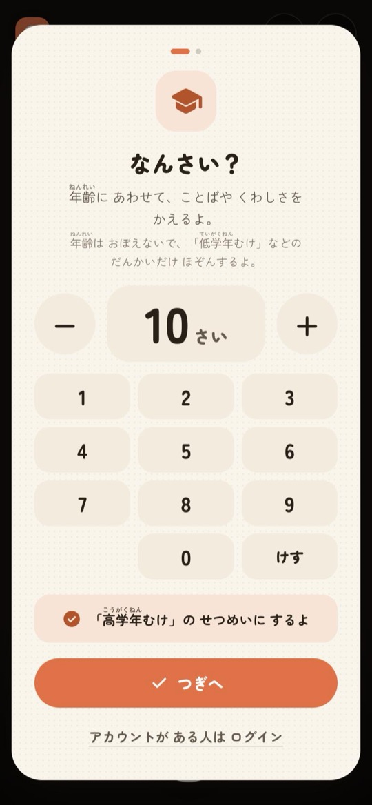
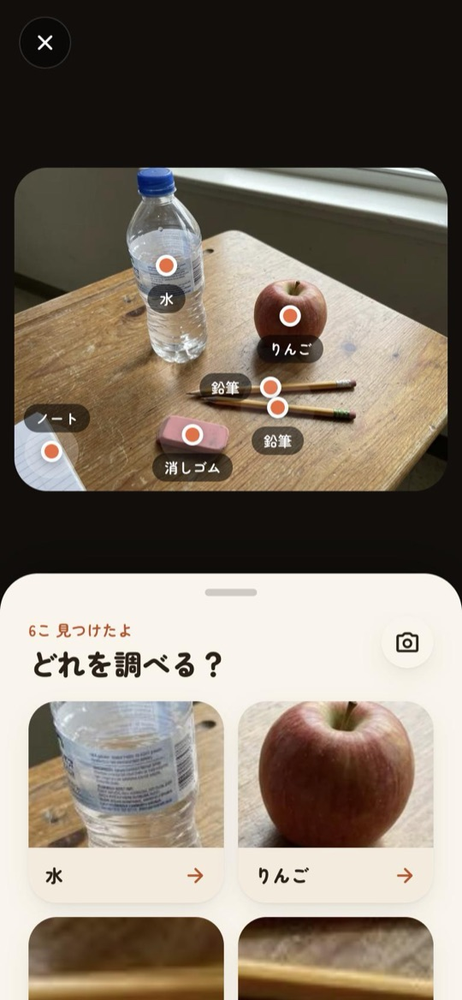
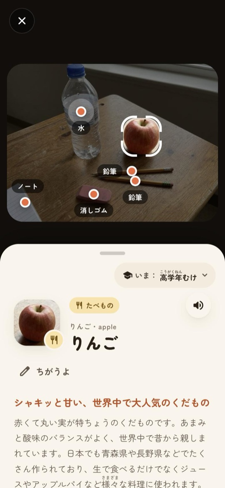
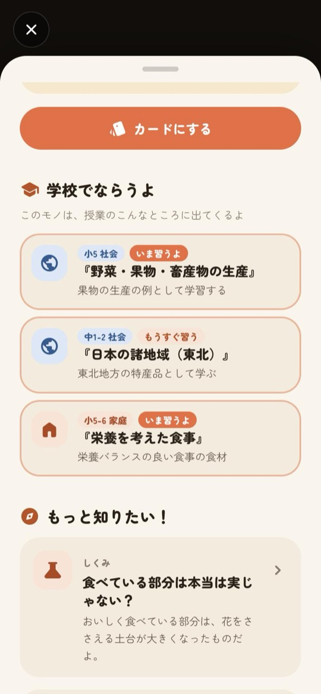
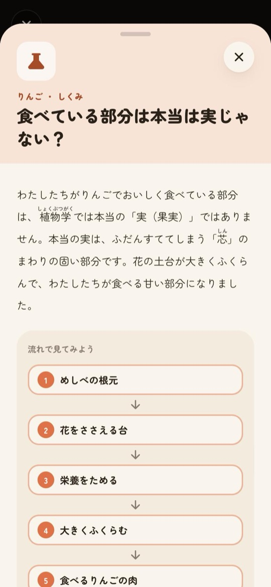
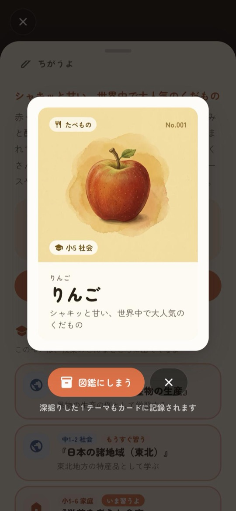
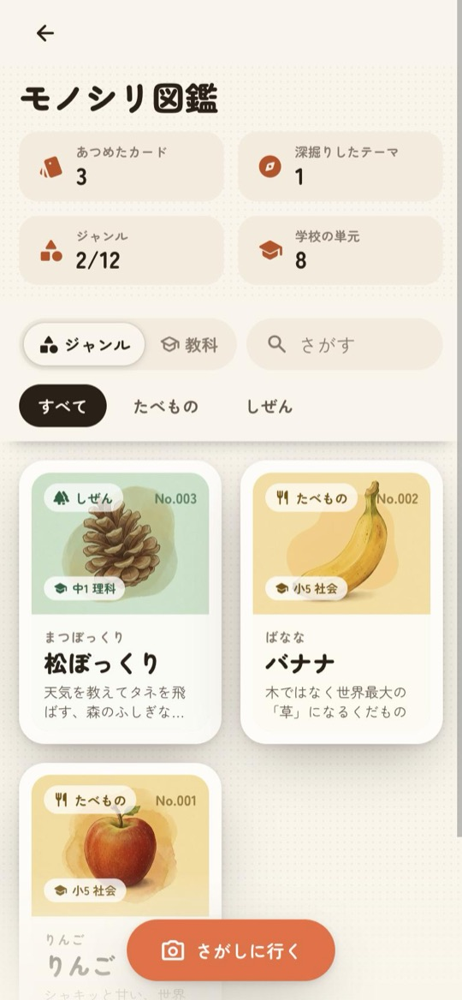
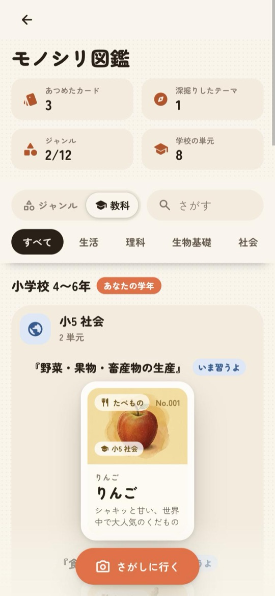

# 画面と機能

[README](../README.md) の「使い方の流れ」を、画面ごとに詳しく説明します。

## はじめて開いたとき

1. **年齢**: 数字キーで年齢を入れる（ゲストも必須）。8歳以下は小学校低学年、9〜11歳は高学年、12〜14歳は中学生、15歳以上は高校生以上の段階に変換し、**段階だけを保存**する（年齢は保存も送信もしない）。
2. **同意**: プライバシーポリシーの要点を見せ、同意を受ける。13歳未満は保護者の同意も確認する。同意の記録は端末にだけ残す。
3. **案内**: 使い方の案内カードと、撮影画面のボタンを順に照らすチュートリアル。

年齢の画面の「アカウントが ある人は ログイン」から、年齢を入れる代わりにログインできます。段階を保存したアカウントでログインすると、年齢・同意・案内を飛ばします（登録のときに同意済みのため）。ログインせずに閉じたときや、段階が保存されていないアカウントのときは年齢の画面にもどります。ログアウトとアカウント削除のあとは、年齢と同意をもう一度聞きます。

 

## 撮る・見つける

- **撮影**: カメラで撮る（タップでピント合わせ）、写真を選ぶ、ドラッグ&ドロップ、貼り付け。カメラが使えないときはサンプル写真（つくえの上・秋の公園・キッチン）でも試せる。
- **検出**: Gemini が写真の中のモノを最大6個見つけ、Lens 風の印と名前を重ねる。下のパネルから調べるモノを選ぶ。
- **安全**: 写真は Cloud Vision の SafeSearch で確認し、不適切なものは検出も解説もしない。撮った写真は端末にもクラウドにも保存しない。

 

## 知る（解説）

- 名前・読み・ジャンル・ひとこと・やさしい説明・豆知識と、6つの「問い」。Google 検索の候補チップと Wikipedia の要約も付く。
- **2段階で表示**: まだ誰も調べていないモノは、名前と説明を約2〜3秒で先に出す。豆知識の場所には「しらべ中　Google 検索で確かめながら、問いを作っています…」と出し、検索で確かめた完成版が届くと差し替える（説明に直しがあればフェードで入れ替わる）。カードにする・読み上げは完成版から使える。
- **ちがうよ**: 名前がちがうときは直して調べ直せる。
- **段階の切り替え**: 上のチップから年齢を入れ直すと段階が変わり、表示中の解説も作り直す。

 

## 学校の単元

- 解説したモノを、学習指導要領（小学校・中学校は平成29年告示、高等学校は平成30年告示）から作った 219 単元に Gemini が結び付ける（一覧の id からだけ選ぶので、ない単元を作らない）。
- 「小5 社会『野菜・果物・畜産物の生産』」のように最大3つを表示し、今の段階に応じて「いま習うよ」「もうすぐ習う」を付ける。段階から見てもう習った単元は出さない。

 

## 深掘り

- 問いを選ぶと、検索で裏付けた本文が少しずつ流れてくる（ストリーミング）。
- 手順や変化は「流れで見てみよう」の流れ図にする。
- 「見て・ためして わかる」: テーマに合う写真（Wikimedia Commons から Gemini が選び、SafeSearch で確認）、YouTube 動画（セーフサーチ厳格）、AI の図解イラスト、AI 動画（合計の本数に上限あり）。図解・動画・クイズは開いたときにだけ作る。
- 3択クイズ、読み上げ、Google で検索、参考にしたページ。

 

## カードと図鑑

- **カード**: Nano Banana が描く絵本風のイラストでカードにする。イラストの完成を待たずに保存でき、できあがると図鑑ボタンの吹き出しで知らせる。深掘りしたテーマもカードに記録される。
- **図鑑**: 集めたカード・深掘りしたテーマ・ジャンル・単元の数、ジャンルの絞り込み、検索、カードの詳細（裏返してノートを書ける）。
- **教科**: 「教科」に切り替えると、集めたカードの単元だけを教科×学年に並べ、単元ごとにカードを中央にそろえて並べる（スマホは2列）。自分の学年には「あなたの学年」が付く。

  
  

 

## 年齢の段階とふりがな

| 段階 | 対象 | 文章 |
|---|---|---|
| `lower` | 小学校 低学年（8歳以下） | ひらがな多めで短く。ふりがな付き。文字を大きくし、解説を自動で読み上げる |
| `upper` | 小学校 高学年（9〜11歳） | 授業で習う言葉で。ふりがな付き |
| `junior` | 中学生（12〜14歳） | しくみや理由まで |
| `senior` | 高校生以上（15歳〜） | 原理まで詳しく |

- ふりがなは Gemini が `漢字《かんじ》` の形で付け、画面では `<ruby>` で表示する。読み上げはふりがなを除いて読む。
- 解説・深掘り・クイズは段階ごとにキャッシュする。ある段階の文章がすでにあれば、別の段階は検索せずに言い換えて作る（[cost.md](cost.md)）。
- カードの ID は段階によらず同じなので、段階を変えても図鑑のカードは1枚のまま。

## アカウント

- ゲスト（匿名）のまま使える。メールアドレス＋パスワード、または Google でログインすると、ゲストで集めたカードを引き継ぎ、どの端末でも同じ図鑑を開ける。
- メールで登録した場合は、アドレスを確認してからクラウドの図鑑を使える。確認とパスワード再設定のメールはアプリと同じ見た目の HTML で、リンクはアプリの `/auth/action` で確認や再設定を済ませ、自動でアプリにもどる。
- 最初のカードと5枚目、ゲストの上限に達したときに登録をすすめる。
- ログアウトすると端末内の図鑑を消す。アカウント削除の前には、もう一度ログインしてもらう。

## そのほか

- **読み上げ**: 文ごとに音声を作り、読んでいる段落をハイライトしながら再生する。
- **学びの記録**: 問いを開いた・クイズに答えた／正解した・カードを保存した、などを日ごとの合計回数だけサーバーで数える（個人とは結び付けない）。`node infra/stats.mjs` で見られる。
- **プライバシー**: `/privacy` に、子どもにも読める「かんたん版」と詳しい版がある。
- **操作**: 詳細画面は下にスワイプして閉じられる。戻る操作（ブラウザの戻る、Android の戻るボタン、iOS の画面の左端からのスワイプ、Esc）は、開いた順に1段ずつ閉じる。オフラインになったら知らせ、図鑑は端末内から表示する。
